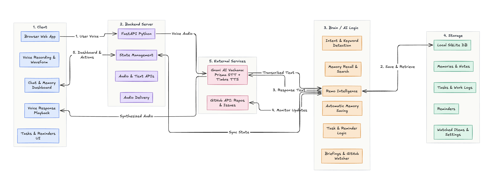

<div align="center">


### Speak once. Remember forever. Know what changed.

**A Hinglish + Marathi voice memory that answers *where you left off* and briefs *what changed while you were away*.**

Run it on your machine or your own server, use it from any browser or phone

[Demo](#demo) | [Architecture](#architecture) | [Get started](#quick-start) | [What it does](#what-remo-does) | [Powered by Gnani AI](#powered-by-gnani-ai) | [Docs](https://docs.gnani.ai)

[](https://www.python.org/)
[](#languages)
[](#powered-by-gnani-ai)
[](LICENSE)

</div>

Remo listens the way Indians actually talk (Hinglish, English, or Marathi) and remembers what matters:
notes, work progress, reminders, and the outside world you asked it to watch. Days later, one question brings it all
back, out loud:

- **Keyword saving:** "yaad rakhna …" / "remember …" / "lakshat thev …" stores instantly. No interrogation.
- **Left-off answers:** pending items first, spoken back in second person ("aapko", never "mujhe").
- **Change watcher:** "watch karo" a GitHub issue or repo; every check stores a checkpoint and the next
  one reports only what is new, with links.
- **Spoken everything:** every reply, briefing, quiz, and alarm in a natural Timbre voice, streamed.
- **Local-first data:** one SQLite file holds notes, reminders, accounts, and sessions. No third-party cloud.
- **Learns your voice:** your vocabulary boosts recognition; stubborn mishearings become automatic fixes.
- **Accounts:** email + password or Google sign-in, with a profile page.

Supported platforms:

- [x] macOS
- [x] Windows
- [x] Linux
- [x] Android / iOS (via any browser)
- [x] Any phone (voice-first design; live call interface on the roadmap)

## Demo

[](https://youtu.be/sqmf190G0R4)

Watch the demo on YouTube: <https://youtu.be/sqmf190G0R4>

## Architecture



Voice or text captured in the browser studio (`1. Client`) is sent to the FastAPI backend (`2. Backend Server`),
which streams 16 kHz audio to **Gnani AI Prisma STT** (`5. External Services`) and passes the transcript to Remo's
orchestration layer (`3. Brain / AI Logic`): one Gemini call returns the intent plus the final grounded reply, with
an exact regex for URLs and a deterministic pattern engine as fallback. Keyword-prefixed utterances save immediately,
while queries, work updates, reminders, and briefings read and write the local SQLite database (`4. Storage`) and
poll watched public GitHub repos/issues (`5. External Services`) using seen-state cursors plus per-press checkpoints.
The reply text is synthesized via **Gnani AI Timbre TTS**, cached on disk, and streamed to the browser over SSE
alongside updated dashboard state.

## What Remo does

| Say this | What happens |
|---|---|
| "Yaad rakhna, maths mein integration ho gaya, differential baaki hai" | Stored instantly with a spoken confirmation. |
| "Maths mein kya bacha hai?" | Pending-first answer, spoken out loud |
| "Yaad rakhna, issue 214: login fix ho gaya, docs baaki hai" | Work entry tracked as done vs pending |
| "Issue 214 mein kya bacha hai?" | Reads the entry back, weeks later |
| "Watch karo https://github.com/o/r/issues/214" | Issue watched with a seen-state cursor |
| "Watchlist mein kya changes hain?" | Short spoken count of only what is new since the last check |
| "Welcome back" | Your pending items + outside changes + a suggested next step |
| "Kal subah 9 baje chai yaad dilana" | Time read back, confirmed, chimed + spoken at 9 |
| "Aaj ka plan batao" | Today's reminders plus your recent notes |
| "Maths mein quiz karo" | Spoken questions from your notes, judged by meaning |
| "Lakshat thev, udya meeting aahe" | The same loop, end to end in Marathi |

PDFs join the loop too: import one from the app and tick the extracted notes to keep them.

## Powered by Gnani AI

Every voice in Remo, in both directions, runs on Gnani's models.

| Model | How Remo uses it |
|---|---|
| **Prisma v2.5** (STT) | Realtime WebSocket streaming (1024-byte PCM, 300 ms silence gate) plus upload fallback; word boosting from your own notes; empty-result retry |
| **Timbre v3.0** (TTS) | Every spoken reply, briefing, quiz, and alarm: Avinash for Hinglish, Zahira for Marathi; single-flight requests, disk cache, SSE streaming playback |
| **Gemini** (reasoning) | One call per turn: intent slots plus the grounded reply over retrieved notes, with quota cooldowns and multi-key rotation |
| **Evon v3.3** (reasoning) | Next on the roadmap: every model call already sits behind one module, so Evon slots in when its API opens |

Get a key at [app.gnani.ai/voice](https://app.gnani.ai/voice). Docs at [docs.gnani.ai](https://docs.gnani.ai).
Built for the [Great Indian AI Internship Challenge 2026](https://www.gnani.ai/internship).

## Quick start

Clone the repository:

```bash
git clone <YOUR-REMO-REPO-URL>
cd Remo
```

Set up the environment and keys:

```bash
python3 -m venv .venv
source .venv/bin/activate
pip install -r requirements.txt
cp .env.example .env   # paste keys: GNANI_API_KEY, GEMINI_API_KEY, Google OAuth for sign-in
```

Check everything (offline tests; live tests need the key):

```bash
.venv/bin/python -m pytest -q
.venv/bin/python -m pytest -m live -q
```

Run the app:

```bash
.venv/bin/python -m uvicorn server:app --host 127.0.0.1 --port 8000
```

then open **http://127.0.0.1:8000**, register on the login page (or Continue with Google
once OAuth is configured), press the mic inside the app, and say "yaad rakhna…".

## A day with Remo

**Evening, two minutes.** You speak your progress: a GSoC update, a spray diary, the day's udhaar, a clinic visit.
Remo files it as done vs pending. **Days later**, "kya bacha hai?" gets a pending-first answer that addresses you
directly. **Welcome back** adds what changed out there: a short spoken count of new commits and comments, each with
a link on screen, never read out twice.

## Noise benchmark

Prisma is benchmarked in-repo on clean, white, rumble, and babble conditions at 16 and 8 kHz
(telephony downsample):

```bash
python scripts/noise_bench.py        # needs GNANI_API_KEY; writes tests/noise/results.md + chart.svg
python scripts/probe_voices.py       # Hinglish/Marathi voice check with listenable wavs in out/
```

Fixtures are Timbre-synthesized Hinglish; overlays are labeled synthetic stand-ins until field recordings land.

## Project layout

```
server.py            FastAPI app: pages, auth, turns, audio, alarms, imports, deletes
remo/
  turn.py            turn router: LLM-first single-call turns + pattern fallback
  llm.py             Gemini backend: rotation, cooldowns, hedging, prompts
  stt.py             Prisma streaming + upload clients
  tts.py             Timbre client: single-flight lock, disk cache, SSE stream
  memory.py          SQLite: notes, work, reminders, watched, check runs, users
  brain_keywords.py  "yaad rakhna" / "remember" / "lakshat thev" gate
  recall.py          hybrid search + pending-first answers (Hinglish/Marathi)
  worklog.py         done/pending entries, personas, welcome-back
  watcher.py         GitHub issue/repo poller with cursors + checkpoints
  reminders.py       Hinglish time parser (Devanagari parity) + firing + chime
  briefing.py        day's plan      quiz.py  voice quiz
  answers.py         haan/nahi       boost.py learned vocabulary
  lang.py            locales         auth.py  accounts + Google OAuth
  timeutil.py        IST app clock   capture/ audio framing
  config.py          settings        paths.py data dir     log.py logging
web/                 browser app, dark studio shell, no framework
landing/             homepage         tests/  356 pytest cases
scripts/             smoke probes, voice probe, noise bench
```

## Languages

Hinglish (Hindi + English, Devanagari + Latin) and Marathi ship end to end: replies, briefings, confirmations, and
watcher summaries. Quiz verdicts and reminder read-backs stay Hinglish-first until a native speaker reviews them.

## Privacy

Your notes, work entries, reminders, accounts, and learned words live in one local-first SQLite file
(`~/.remo` on your machine, your own volume on a host you run). Voice goes to Gnani for transcription,
text goes to Gnani for speech. Watched URLs are polled as plain public requests. Your notes never leave
for them. Retrieved snippets go to Gemini so answers sound natural; if its keys are down, answers fall
back to your exact words offline. The demo uses made-up data only.

## Roadmap

Live phone-call interface, Evon-powered reasoning upgrades, field-recorded noise fixtures,
sentence-level speech overlap.

## License

MIT, see [LICENSE](LICENSE).

---

*Speech recognition and speech by [Gnani AI](https://gnani.ai) (Prisma, Timbre). Built solo for the
Great Indian AI Internship Challenge 2026. #GreatIndianAIInternshipChallenge #GnaniAI*
