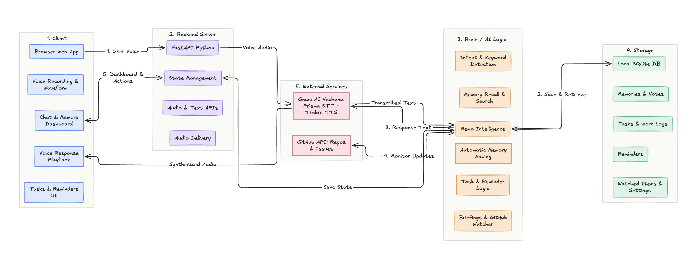

<div align="center">


# Remo

### Speak once. Remember forever. Know what changed.

**A Hinglish + Marathi voice memory that answers *where you left off* and briefs *what changed while you were away*.**

Runs on your machine · use it from any browser or phone

[Demo](#demo) ·
[Architecture](#architecture) ·
[Get started](#quick-start) ·
[What it does](#what-remo-does) ·
[Powered by Gnani AI](#powered-by-gnani-ai) ·
[Docs](https://docs.gnani.ai)

[](https://www.python.org/)
[](#languages)
[](#powered-by-gnani-ai)
[](LICENSE)

</div>

Remo listens the way Indians actually talk (Hinglish, English, or Marathi) and remembers what matters:
notes, work progress, reminders, and the outside world you asked it to watch. Days later, one question brings it all
back, out loud:

- **Keyword saving:** "yaad rakhna …" / "remember …" / "lakshat thev …" stores instantly. No interrogation.
- **Left-off answers:** pending items first, with when you last spoke.
- **Change watcher:** "watch karo" a GitHub issue or repo; "welcome back" briefs only what is new, with links.
- **Spoken everything:** every reply, briefing, quiz, and alarm in a natural Timbre voice.
- **Local-first:** notes, reminders, and keys stay on your machine. No Remo server exists.
- **Learns your voice:** your vocabulary boosts recognition; stubborn mishearings become automatic fixes.

Supported platforms:

- [x] macOS
- [x] Windows
- [x] Linux
- [x] Android / iOS (via any browser)
- [x] Any phone (voice-first design; live call interface on the roadmap)

## Demo

[](https://youtu.be/AwqtV3njztQ)

Watch the demo on YouTube: <https://youtu.be/AwqtV3njztQ>

## Architecture



Voice or text captured in the browser studio (`1. Client`) is sent to the local FastAPI backend (`2. Backend Server`), which streams 16 kHz audio to **Gnani AI Prisma STT** (`5. External Services`) and passes the transcript to Remo's orchestration layer (`3. Brain / AI Logic`). Keyword-prefixed utterances save immediately, while queries, work updates, reminders, and briefings read and write to the local SQLite database (`4. Storage`) and poll watched public GitHub repos/issues (`5. External Services`) using seen-state cursors. The reply text is synthesized back into speech via **Gnani AI Timbre TTS**, cached on disk, and streamed to the browser alongside updated dashboard state.

## What Remo does

| Say this | What happens |
|---|---|
| "Yaad rakhna, maths mein integration ho gaya, differential baaki hai" | Stored instantly with a spoken confirmation. |
| "Maths mein kya bacha hai?" | Pending-first answer, spoken out loud |
| "Yaad rakhna, issue 214: login fix ho gaya, docs baaki hai" | Work entry tracked as done vs pending |
| "Issue 214 mein kya bacha hai?" | Reads the entry back, weeks later |
| "Watch karo https://github.com/o/r/issues/214" | Issue watched with a seen-state cursor |
| "Welcome back" | Your pending items + outside changes + a suggested next step |
| "Kal subah 9 baje chai yaad dilana" | Time read back, confirmed, chimed + spoken at 9 |
| "Aaj ka plan batao" | Today's reminders plus your recent notes |
| "Maths mein quiz karo" | Spoken questions from your notes, judged by meaning |
| "Lakshat thev, udya meeting aahe" | The same loop, end to end in Marathi |

## Powered by Gnani AI

Every voice in Remo, in both directions, runs on Gnani's models.

| Model | How Remo uses it |
|---|---|
| **Prisma v2.5** (STT) | Realtime WebSocket streaming (1024-byte PCM, 300 ms silence gate) plus REST fallback; word boosting from your own notes; empty-result retry |
| **Timbre v2.5** (TTS) | Every spoken reply, briefing, quiz, and alarm: Nalini for Hinglish, Zahira for Marathi; single-flight requests with a disk cache |
| **Evon v3.3** (reasoning) | Next on the roadmap: today's understanding is extractive (no LLM in the loop), so recall works offline and deterministically |

Get a key at [app.gnani.ai/voice](https://app.gnani.ai/voice) · Docs at [docs.gnani.ai](https://docs.gnani.ai) ·
Built for the [Great Indian AI Internship Challenge 2026](https://www.gnani.ai/internship).

## Quick start

Clone the repository:

```bash
git clone <YOUR-REMO-REPO-URL>
cd Remo
```

Set up the environment and keys:

```bash
python3 -m venv .venv
source .venv/bin/activate
pip install -r requirements.txt
cp .env.example .env   # paste your key from https://app.gnani.ai/voice
```

Check everything (offline tests; live tests need the key):

```bash
python -m pytest -q
python -m pytest -m live -q
```

Run the app:

```bash
.venv/bin/python -m uvicorn server:app --host 127.0.0.1 --port 8000
```

then open **http://127.0.0.1:8000** in a browser, press the mic, and say "yaad rakhna…".

## A day with Remo

**Evening, two minutes.** You speak your progress: a GSoC update, a spray diary, the day's udhaar, a clinic visit.
Remo files it as done vs pending. **Days later**, "kya bacha hai?" gets a pending-first answer with the last-update
date. **Welcome back** adds what changed out there: new comments, merged PRs, shifted milestones, each with a link,
each announced with its as-of time so cached news is never presented as live.

## Noise benchmark

Prisma is benchmarked in-repo on fan, traffic, and crowd noise at 16 and 8 kHz (telephony downsample):

```bash
python scripts/noise_bench.py        # needs GNANI_API_KEY; writes tests/noise/results.md + chart.svg
python scripts/probe_voices.py       # Hinglish/Marathi voice check with listenable wavs in out/
```

Fixtures are Timbre-synthesized Hinglish; overlays are labeled synthetic stand-ins until field recordings land.

## Project layout

```
server.py            FastAPI app: mic turns, timeline, briefings, alarms
remo/
  turn.py            one voice turn: routing + voice-out (text fallback)
  stt.py             Prisma streaming + REST clients
  tts.py             Timbre client: single-flight, disk cache
  memory.py          SQLite: notes, work, reminders, watched, learned
  brain_keywords.py  "yaad rakhna" / "remember" / "lakshat thev" gate
  recall.py          hybrid search + pending-first answers (Hinglish/Marathi)
  worklog.py         done/pending entries, personas, welcome-back
  watcher.py         GitHub issue/repo poller with seen-state cursors
  reminders.py       Hinglish time parser + persistent scheduler + chime
  briefing.py        day's plan      quiz.py  voice quiz
  answers.py         haan/nahi       boost.py learned vocabulary
  lang.py            locales         capture/ audio framing
web/                 browser app (Olive Loft)
landing/             about page       tests/  190+ pytest cases
scripts/             smoke probes, voice probe, noise bench
```

## Languages

Hinglish (Hindi + English, Devanagari + Latin) and Marathi ship end to end: replies, briefings, confirmations, and
watcher summaries. Quiz verdicts and reminder read-backs stay Hinglish-first until a native speaker reviews them.

## Privacy

Your notes, work entries, reminders, keys, and learned words stay on your machine (`~/.remo`).
Voice goes to Gnani for transcription, text goes to Gnani for speech. Watched URLs are polled as plain public
requests. Your notes never leave for them. The demo uses made-up data only.

## Roadmap

Live phone-call interface · PDF note imports · Evon-powered reasoning upgrades · field-recorded noise fixtures.

## License

MIT, see [LICENSE](LICENSE).

---

*Speech recognition and speech by [Gnani AI](https://gnani.ai) (Prisma, Timbre). Built solo for the
Great Indian AI Internship Challenge 2026. #GreatIndianAIInternshipChallenge #GnaniAI*
